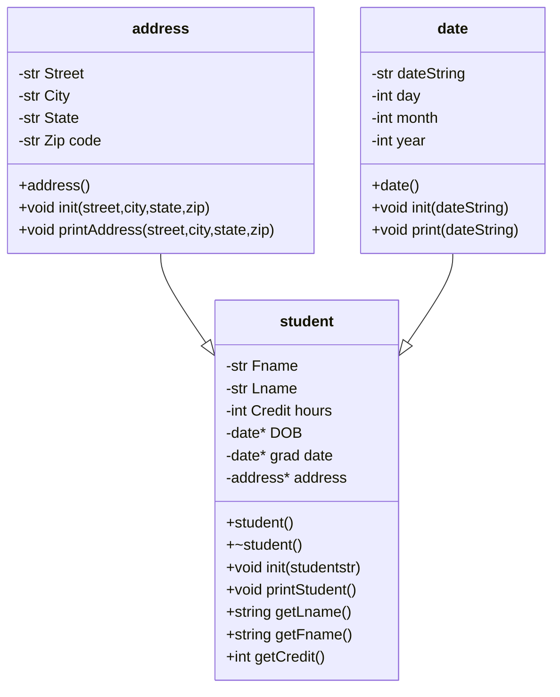

include libraries

## UML


## Address::Address()
```
string street=""
string city=""
string state=""
string zip=""
```

## Address::init(street,city,state,zip)
```
address::street=street
address::city=city
address::state=state
address::zip=zip
```

## Address::printAddress()
```
print all address details with prompt of "address detail: " and new line
```

## Date::Date()
```
string dateString=""
string day=""
string month=""
string year=""
```

## Date::init(dateString)
```
for parser with /
    Date::month=parser

for parser with /
    Date::day=parser

for parser
    Date::year=parser
```

## Date::printDate(dateString)
```
print date with respective headers of "date info" + Date::attributes and new line
```

## Student::Student()
```
string Fname=""
string Lname=""
int creditHours=0
string DOB=Date*
string gradDate=Date*
string Address=Address*
```

## Student::~Student()
```
delete DOB*
delete gradDate*
delete Address*
```

## Student::init(Studentstr)
```
for parse with ,
    Student::Fname = parse
for parse with ,
    Student::Lname = parse
for parse 
    Student::creditHours = parse
```

## Student::printStudent()
```
print data with appropriate data header like "First Name: " plus Student::Fname data
```

